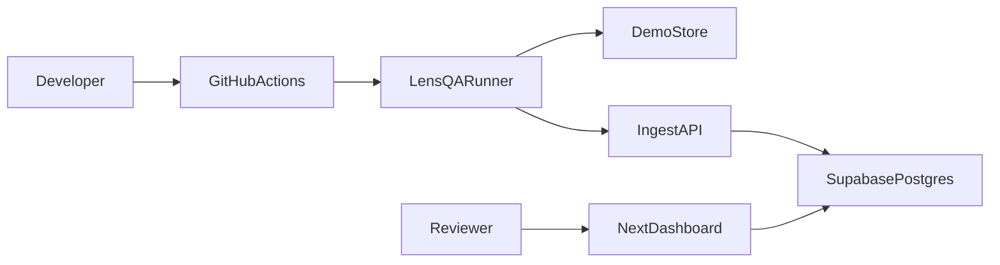

# LensQA — Frontend Quality Cloud

Catch the CSS bug that kills checkout — before revenue does.

Created and maintained by [KhyFee](https://github.com/KhyFee).

LensQA is a portfolio-grade frontend quality platform: deterministic Playwright workers inspect **visual**, **accessibility**, **performance**, **network**, **responsive**, **SEO**, and **runtime** quality, while a cinematic Next.js dashboard manages teams, live runs, private artifacts, baseline governance, analytics, and integrations.

## Open-source release

LensQA was developed privately before its initial public release. It is now open source so developers can use it freely, learn from it, report problems, and improve it together.

The project uses the [MIT License](LICENSE). Contributions are welcome—see [CONTRIBUTING.md](CONTRIBUTING.md) and the public roadmap in GitHub Issues.

## Why it exists

E-commerce teams lose money when a bad CSS merge hides the mobile checkout button. Shift-left visual + quality automation is table stakes for remote hiring in 2026. LensQA proves you can ship the product *and* the QA system around it.

## Monorepo

| Path | Role |
|---|---|
| [`apps/web`](apps/web) | Next.js 16 dashboard + marketing + ingest API |
| [`apps/demo-store`](apps/demo-store) | Deterministic Lumen Market fixture (`LENSQA_REGRESSION=1` breaks checkout) |
| [`packages/runner`](packages/runner) | Playwright 1.61 suite + `lensqa` CLI |
| [`packages/sdk`](packages/sdk) | Typed TypeScript API client |
| [`packages/shared`](packages/shared) | Shared types, confidence score, flake score |
| [`supabase`](supabase) | Schema, RLS, seed |
| [`extension`](extension) | MV3 one-click capture draft |
| [`docs`](docs) | Architecture notes |

## Quick start

```bash
cd lensqa
cp .env.example .env
npm install
npm run build -w @lensqa/shared

# Demo storefront
npm run dev:store

# Dashboard (demo data works without Supabase)
npm run dev

# Visual + quality suite
npm run test:visual

# Deliberate mobile checkout regression (should FAIL)
npm run demo:regression
```

Open:
- Marketing: http://localhost:3000
- Dashboard: http://localhost:3000/dashboard
- Failed run demo: http://localhost:3000/runs/run_fail
- Diff review: http://localhost:3000/review/res_fail_cart_mobile
- Press `⌘K` / `Ctrl+K` for the command palette

## Architecture



Browsers only run in the Playwright container / CI. The hosted dashboard never executes untrusted browser jobs.

## Security model

- RLS on every tenant table (`supabase/migrations`)
- Private `artifacts` storage bucket
- API tokens & webhook secrets stored as hashes
- HMAC signatures on run ingest (`x-lensqa-signature`)
- GitHub webhook signature verification
- AI triage **off by default**; never uploads private screenshots unless explicitly enabled

## Runner CLI

```bash
npx tsx packages/runner/src/cli.ts init
npx tsx packages/runner/src/cli.ts list
npx tsx packages/runner/src/cli.ts run
npx tsx packages/runner/src/cli.ts upload .lensqa/last-run.json
```

Config: [`lensqa.config.ts`](lensqa.config.ts)

## Docker

```bash
docker build -t lensqa .
docker run --rm -it lensqa
```

Image: `mcr.microsoft.com/playwright:v1.61.0-noble` (version-matched).

## CI

- [`.github/workflows/visual-tests.yml`](.github/workflows/visual-tests.yml) — Playwright in official container, HTML report artifact
- [`.github/workflows/ci.yml`](.github/workflows/ci.yml) — build/typecheck/shared tests

Manual regression demo: Actions → Visual Tests → `regression=true`

## Motion system

Anime.js is centralized under [`apps/web/lib/motion`](apps/web/lib/motion):
- Respects `prefers-reduced-motion`
- In-app Motion toggle
- `?motion=off` for deterministic dashboard screenshots
- Transform/opacity only

## Demo script (recruiter)

1. Open marketing page (hero + pipeline)
2. Dashboard → failed run `fix/checkout-css`
3. Swipe/blink the visual diff
4. Press `A` / `R` / `I` for review actions
5. Show analytics + settings token generation
6. Optionally run `npm run demo:regression` and open Playwright HTML report

## Local Supabase (optional)

```bash
npx supabase start
npx supabase db reset
npm run db:types
```

Without Supabase, the web app uses seeded demo data.

## API

- `GET /api/health` · `GET /api/ready` · `GET /api/version`
- `POST /api/ingest/runs` (Bearer + optional HMAC)
- `POST /api/tokens`
- `GET /api/export/:runId?format=json|csv|junit`
- `GET /openapi`

SDK: `@lensqa/sdk`

## Limitations / honesty

- Demo mode does not persist to Postgres until Supabase is configured
- Visual baselines must be generated once on your machine/CI (`npx playwright test --update-snapshots`)
- GitHub App / self-hosted runners / billing are scaffolded for portfolio depth — wire credentials to go live
- Motion MCP was unavailable; Anime.js MCP patterns power the motion layer

## License

MIT © 2026 [KhyFee](https://github.com/KhyFee)
