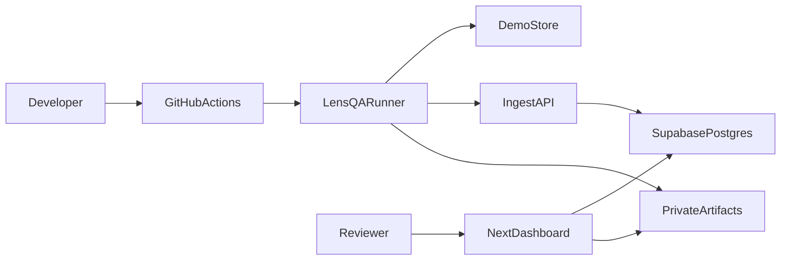

# LensQA architecture

## Packages
- `apps/web` — Next.js dashboard + marketing
- `apps/demo-store` — deterministic e-commerce fixture
- `packages/runner` — Playwright CLI + visual/quality tests
- `packages/sdk` — typed API client
- `packages/shared` — shared types + confidence/flake helpers
- `extension` — MV3 capture helper
- `supabase` — migrations, seed, local config
